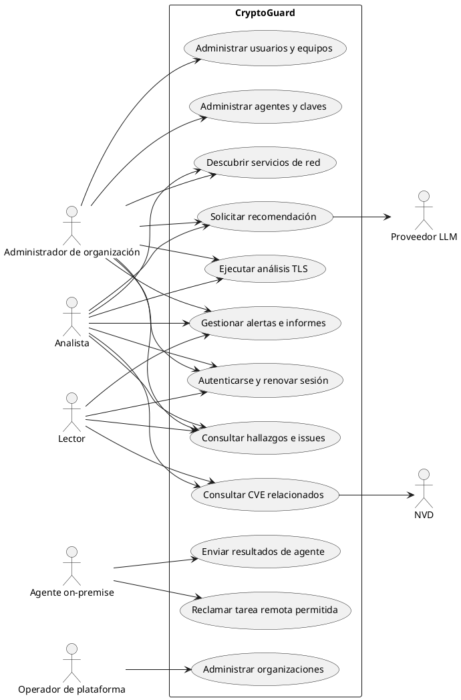
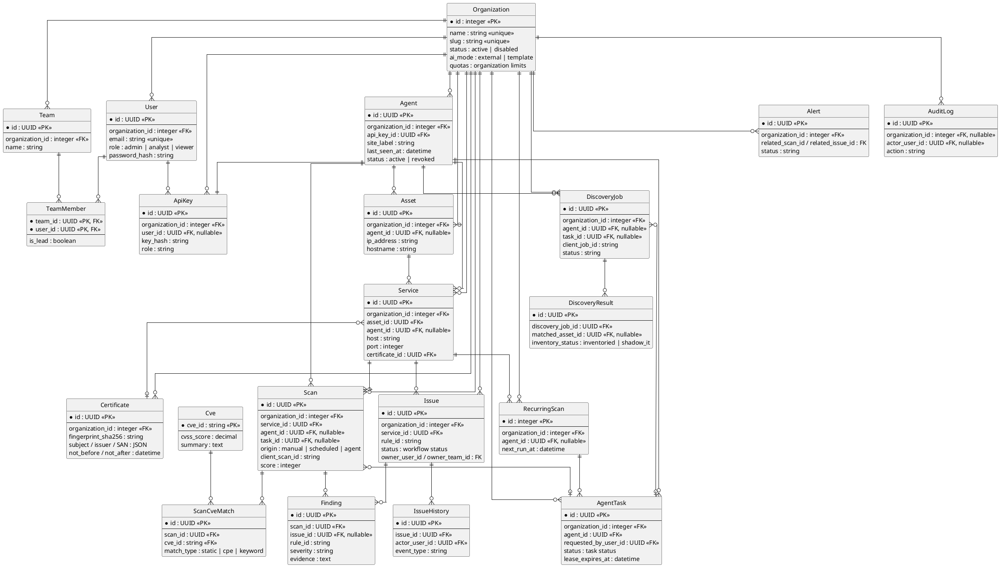
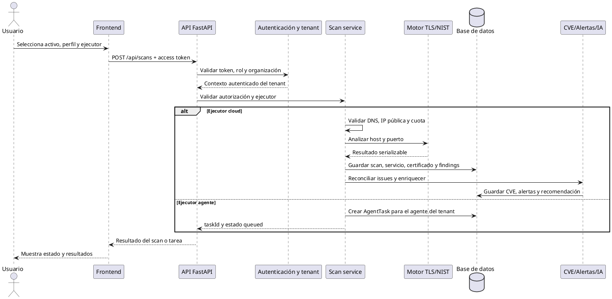
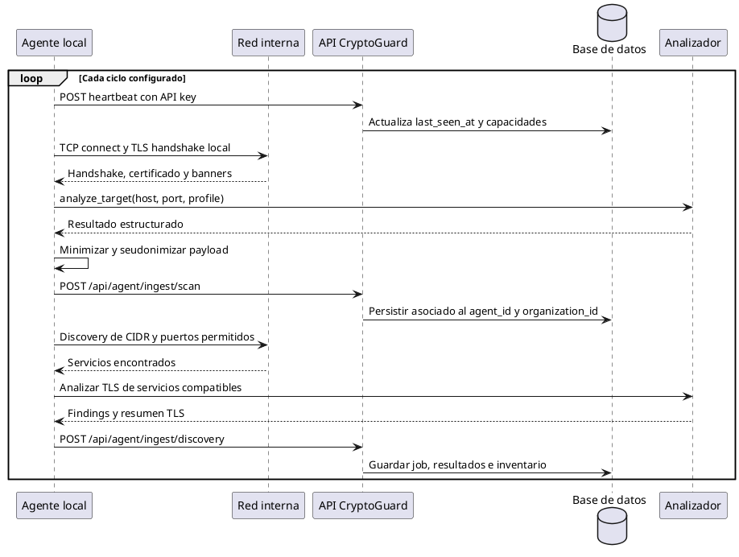

# CryptoGuard: arquitectura y funcionamiento de la solución

## Propósito y alcance

Este documento describe la arquitectura final de CryptoGuard como plataforma de gestión de postura de seguridad TLS para múltiples organizaciones, complementada por agentes de recolección instalados dentro de las redes de los clientes. Se presenta la solución como un diseño integral: componentes, responsabilidades, datos, flujos operativos, interfaces, controles de seguridad y estrategia de pruebas.

CryptoGuard evalúa servicios y certificados TLS frente a reglas técnicas derivadas de NIST, registra hallazgos y su evolución, relaciona hallazgos con CVE cuando existe evidencia suficiente, descubre servicios de red, genera alertas e informes y ofrece recomendaciones explicables. La plataforma no explota vulnerabilidades, no instala parches y no ejecuta acciones de remediación sobre los activos.

El agente mencionado en este documento es un **programa de recolección de datos de red**, no un agente de inteligencia artificial. El modelo de lenguaje es una integración opcional y acotada a la redacción de recomendaciones.

La revisión de código Java usa el endpoint autenticado `POST /api/crypto-ml/analyze`. El backend ejecuta el análisis localmente y devuelve indicios, observaciones y limitaciones. El endpoint no persiste el código fuente.

## Objetivos de diseño

- Permitir la administración centralizada de varias organizaciones con aislamiento estricto de sus datos.
- Analizar activos públicos desde la plataforma y activos internos desde un agente instalado en la red autorizada.
- Mantener el motor de análisis reutilizable e independiente de la API y de la base de datos.
- Dar trazabilidad entre un activo, sus servicios, las ejecuciones de análisis, los hallazgos, los CVE relacionados y las acciones de seguimiento.
- Limitar la salida de datos del agente mediante niveles de carga y seudonimización local.
- Producir recomendaciones con IA sin delegar al modelo la detección, severidad ni priorización objetiva de vulnerabilidades.
- Mantener una experiencia de uso que permita filtrar por organización, agente, sede y período.

## Actores y casos de uso

| Actor | Responsabilidad |
|---|---|
| Administrador de organización | Gestiona usuarios, equipos, agentes, configuración y controles de su organización. |
| Analista | Ejecuta análisis autorizados, revisa resultados, asigna issues y prepara informes. |
| Lector | Consulta dashboards, inventario, resultados e informes sin modificar datos. |
| Agente on-premise | Realiza escaneos locales programados y, cuando se habilita explícitamente, procesa tareas remotas autorizadas. |
| Operador de plataforma | Crea, habilita, deshabilita y elimina organizaciones mediante herramientas administrativas fuera de la API de usuario. |
| Servicios externos | NVD aporta metadatos de CVE; el proveedor LLM puede redactar recomendaciones si la organización lo permite. |

### Casos de uso principales

El siguiente modelo muestra las capacidades funcionales ofrecidas a los actores. La autenticación y el aislamiento por organización se aplican a todas las operaciones protegidas.



## Arquitectura lógica

CryptoGuard se divide en dos planos de ejecución. El **plano de control** concentra identidad, políticas, persistencia, presentación y correlación. El **plano de recolección** vive dentro de la red del cliente y ejecuta las conexiones de escaneo hacia activos internos.

<!-- mermaid-checked: no \n, no em-dash/en-dash, no {} in labels, subgraphs are id["label"], arrows are -->|"label"|, all subgraphs closed by end, ids unique -->
~~~mermaid
flowchart TD
    subgraph Client["Clientes"]
        Browser["Navegador"]
        Agent["Agente de recoleccion"]
        Targets["Activos de red"]
    end
    subgraph Cloud["Plano de control CryptoGuard"]
        Frontend["Frontend Next.js"]
        API["API FastAPI"]
        Services["Servicios de aplicacion"]
        Core["Motor de analisis TLS y reglas"]
        Scheduler["Schedulers"]
        DB[("SQLite o PostgreSQL")]
    end
    subgraph Providers["Servicios externos"]
        NVD["NVD API"]
        LLM["Proveedor LLM opcional"]
    end

    Browser -->|"HTTPS y JSON"| Frontend
    Frontend -->|"API REST"| API
    Agent -->|"HTTPS saliente e ingesta"| API
    Agent -->|"escaneo local"| Targets
    API -->|"validacion y rutas"| Services
    Services -->|"analisis"| Core
    Services -->|"persistencia"| DB
    Scheduler -->|"trabajos programados"| Services
    Services -->|"CPE o keywords sin identidad del host"| NVD
    Services -.->|"findings saneados y anonimizados"| LLM
~~~

### Tecnología y responsabilidad por capa

| Capa | Tecnología | Responsabilidad |
|---|---|---|
| Interfaz | Next.js App Router, React, TypeScript, Tailwind CSS, Radix UI, Recharts | Inicio de sesión, dashboards, inventario, análisis, discovery, issues, agentes e informes. |
| API | Python, FastAPI, Pydantic | Contratos HTTP/JSON, autenticación, validación, autorización por rol y coordinación de operaciones. |
| Servicios | Python, SQLAlchemy 2 | Orquestación de escaneos, persistencia, reconciliación de issues, alertas, CVE, agentes y reportes. |
| Motor | Python, `ssl`, sockets, `asyncio`, `cryptography` y módulos propios | Handshake, certificados, fingerprinting, reglas NIST, score y discovery. |
| Persistencia | SQLite para desarrollo/instalación pequeña; PostgreSQL para plataforma compartida | Datos operativos, configuración, inventario, auditoría y resultados. |
| Migraciones | Alembic | Evolución explícita del esquema de la base de datos. |
| Programación | APScheduler y ejecución acotada en proceso | Escaneos recurrentes y evaluación periódica de alertas. |
| Comunicación agente | `httpx`, HTTPS, JSON, API key individual | Ingesta, heartbeat y polling opcional de tareas remotas. |
| CVE | NVD Vulnerability API 2.0 por HTTPS | Enriquecimiento de coincidencias mediante CPE o consultas acotadas por keyword. |
| IA | Proveedor Anthropic o Gemini mediante `httpx`; proveedor de plantillas como alternativa | Redacción de recomendaciones sin intervenir en la evaluación determinista. |
| Visualización operacional | Grafana e Infinity datasource | Consulta de informes expuestos por la API. |
| Pruebas | pytest, TestClient, `httpx` mockeado, pytest de integración y E2E | Pruebas de componentes, API, aislamiento, integraciones y flujos completos. |

La plataforma publica una API REST consumida por el frontend, por Grafana y por los agentes. Los agentes no requieren una conexión entrante desde la nube: inician conexiones HTTPS hacia la plataforma y procesan localmente las redes que su configuración permite. En la plataforma compartida, PostgreSQL es el motor recomendado; SQLite sigue siendo adecuado para desarrollo y despliegues pequeños.

### Decisiones arquitectónicas

- El motor puro de análisis se separa de la persistencia: una misma lógica es invocada por la plataforma y por el agente.
- La organización es el límite de tenant; toda operación de usuario o agente queda asociada a una organización y el acceso a datos se filtra de manera fail-closed.
- La nube solo escanea destinos públicos después de validar direcciones y resolución DNS. Los destinos internos se alcanzan desde el agente.
- Los resultados de análisis basados en reglas son deterministas; la IA es opcional, no tiene herramientas y no puede cambiar findings ni su severidad.
- Cada agente posee credenciales propias, un ámbito de organización y una política local que la plataforma no puede ampliar.
- El runtime de producción utiliza un único proceso de backend mientras los schedulers y límites en memoria no estén distribuidos.

## Modelo de datos

### Entidades y responsabilidades

| Entidad | Propósito y relaciones relevantes |
|---|---|
| `Organization` | Tenant cliente; define estado, modo de IA, límites y configuración de seguridad. |
| `User` | Identidad de una persona, rol y organización única. El email es globalmente único para permitir login sin selector de tenant. |
| `Team` / `TeamMember` | Agrupación de usuarios dentro de la organización para ownership y gestión de remediación. |
| `ApiKey` | Credencial API hasheada, asociada a usuario o agente y a una organización; incluye rol, estado y expiración. |
| `RefreshToken` | Token de sesión persistido como hash, con vencimiento, revocación y rotación. |
| `Agent` | Recolector instalado en una sede; pertenece a una organización y mantiene estado, versión, heartbeat y capacidades informativas. |
| `Asset` | Host/IP conocido en el inventario, con procedencia y agente opcional. |
| `Service` | Servicio detectado en un host y puerto. Su identidad se limita a la organización o al agente propietario. |
| `Certificate` | Atributos técnicos del certificado observado: huellas, vigencia, clave, firma, subject, issuer y SAN. |
| `Scan` | Ejecución de análisis TLS con origen, resultado, score, fecha, servicio, agente opcional y nivel de carga. |
| `Finding` | Resultado de una regla evaluada durante un scan, con evidencia, severidad, estándar y recomendación estática. |
| `Issue` / `IssueHistory` | Ciclo de vida de remediación y trazabilidad de transiciones de un hallazgo recurrente. |
| `ScanCveMatch` | Relación de un scan con CVE estáticos o recuperados por NVD, con tipo de coincidencia y estado de verificación. |
| `Cve` / `CveQueryCache` | Catálogo global de CVE y caché global de consultas NVD; no contienen datos identificatorios del activo. |
| `DiscoveryJob` / `DiscoveryResult` | Trabajo de descubrimiento y servicios encontrados; incluye clasificación inventariado/shadow IT. |
| `RecurringScan` | Configuración de ejecución periódica; los trabajos pueden ejecutarse en nube o delegarse al agente. |
| `AgentTask` | Tarea remota tipada para un agente, con lease, expiración, reintentos y resultado asociado. |
| `Alert` / `AlertThreshold` / `ComplianceWindow` | Notificaciones de riesgo y preferencias por organización. |
| `AuditLog` | Registro append-only de eventos administrativos y de seguridad atribuibles a una organización o al operador. |

### Diagrama entidad-relación lógico

El diagrama muestra las relaciones principales. Los datos operativos pertenecen a una organización; las tablas hijas heredan ese ámbito a través de la entidad padre. `Cve` y la caché NVD son globales porque representan información pública reutilizable.



### Reglas de aislamiento e identidad

- `organization_id` identifica el tenant dueño de cada fila raíz de cliente y tiene índice y clave foránea a `Organization`.
- Las consultas ORM a modelos tenant aplican automáticamente el filtro de la organización presente en la sesión. Una sesión de request sin tenant explícito falla; el modo de sistema se reserva a tareas administrativas controladas.
- Los inserts heredan la organización de la sesión y se rechaza cambiar de tenant una entidad persistida.
- Los recursos ajenos se responden como `404` para no revelar su existencia.
- Las entidades hijas —por ejemplo `Finding`, `DiscoveryResult` e `IssueHistory`— se consultan a través de sus padres o incluyen el alcance necesario cuando se consultan directamente.
- `Service` mantiene identidad separada por agente cuando lo reporta un agente, o por organización cuando lo escanea la plataforma. El mismo host y puerto de dos organizaciones no se fusionan.
- El email de usuario es globalmente único; los equipos tienen nombres únicos dentro de su organización.
- Las claves, relaciones y filtros se verifican también en operaciones de detalle, actualización, borrado, agregación, reportes y tareas programadas.

## Funcionamiento de la solución

### 1. Análisis TLS y handshake

Al iniciar un scan, el motor recibe host, puerto, perfil y timeout. Si el puerto principal no está disponible y se definieron puertos alternativos, comprueba el alternativo y conserva cuál fue utilizado. Luego realiza la negociación TLS y extrae los datos observables de la conexión. No necesita autenticarse como el servidor: analiza la configuración que el endpoint ofrece al cliente.

El handshake permite observar la dirección resuelta, versión TLS negociada, cipher suite, extensiones disponibles, ALPN y metadatos relacionados. El flujo extrae el certificado del peer desde los bytes DER recibidos; si hace falta, abre una conexión adicional para recuperar la cadena. Del certificado se analizan la huella SHA-256, sujeto, emisor, SAN, fechas de vigencia, algoritmo/tamaño de clave, firma y extensiones relevantes. Un fingerprint complementario usa atributos del handshake (JA3/JA3S cuando hay datos suficientes) y, de forma best-effort, banner grabbing para identificar software y versión.

El pipeline se representa como:

```text
Solicitud de scan
  -> Validación de destino y perfil
  -> Selección de puerto efectivo
  -> Resolución DNS y conexión TCP
  -> Negociación TLS y captura del certificado
  -> Análisis de cadena, handshake y fingerprint
  -> Evaluación de reglas NIST
  -> Cálculo de score y DTO serializable
  -> Persistencia, issues, CVE, alertas y recomendación
```

El núcleo (`analyze_target`) devuelve un resultado serializable y no abre una sesión de base de datos. El backend añade persistencia y efectos de plataforma; el agente usa el mismo núcleo y decide localmente qué campos enviar.

### 2. Evaluación de configuración y hallazgos

Los datos observados se comparan mediante reglas deterministas con los estándares y políticas adoptados, incluyendo NIST SP 800-52 Rev.2, SP 800-57 Part 1 y SP 800-131A. Las reglas revisan, según corresponda, versiones de protocolo, suites criptográficas, intercambio de claves, certificados, longitudes y algoritmos criptográficos, extensiones y otros atributos del handshake.

Cada hallazgo contiene identificador de regla, título, descripción, evidencia técnica, severidad, categoría, recomendación de remediación y referencia normativa. Una regla que no puede determinarse con la evidencia disponible se representa como no evaluable, en lugar de convertir falta de información en un resultado positivo o negativo. El score es calculado por el motor, no por el LLM.

Al persistir un scan, CryptoGuard crea o actualiza el inventario de servicio y certificado, almacena findings, y reconcilia los hallazgos recurrentes con `Issue`. La reconciliación puede crear un issue nuevo, registrar que continúa presente, marcarlo como resuelto al desaparecer, verificarlo después de los scans limpios requeridos o reabrirlo si vuelve a aparecer. El historial registra transiciones, actor, fecha y comentario.

### 3. Descubrimiento de red

El discovery expande las entradas configuradas (CIDR, IP o dominios resueltos) y examina los puertos seleccionados mediante conexiones TCP asíncronas con concurrencia acotada y timeout. Para los puertos que pueden ofrecer TLS intenta un handshake de detección; en servicios compatibles obtiene un banner best-effort y aplica fingerprinting. El resultado incluye IP, hostname disponible, puerto, nombre de servicio, presencia/versión TLS y alcance interno o externo.

La plataforma persiste el trabajo como `DiscoveryJob` y cada hallazgo como `DiscoveryResult`. Compara IP/hostname con los `Asset` de la misma organización (y del agente correspondiente cuando el trabajo viene de un agente):

- `inventoried`: coincide con un activo que ya forma parte del inventario.
- `shadow_it`: servicio detectado sin una correspondencia conocida.

Desde un discovery cloud se validan todos los destinos y el tamaño total del rango antes de conectar. Los rangos privados, reservados, loopback, link-local, multicast y metadatos de nube se bloquean. La validación DNS comprueba todas las direcciones resultantes y la conexión usa la dirección ya validada para reducir riesgo de DNS rebinding. El discovery interno se realiza desde el agente local, que no abre puertos de escucha.

Cuando un servicio descubierto ofrece TLS, el agente completa además el análisis TLS del servicio con el mismo motor de análisis. El discovery y los scans resultantes llevan identificadores de cliente para hacer la ingesta idempotente.

### 4. Correlación con CVE y consultas NVD

CryptoGuard combina dos mecanismos complementarios:

1. **Mapping estático regla-CVE:** reglas de detección conocidas se relacionan con CVE relevantes mediante un mapping versionado del proyecto. Esta relación es local, rápida y se conserva como evidencia de por qué se asoció el CVE a un finding.
2. **Enriquecimiento con NVD:** cuando el fingerprint de software tiene confianza alta, el nombre y versión se traducen a CPE y se consulta NVD Vulnerability API 2.0. Para findings sin mapping estático se pueden formar hasta cinco keywords técnicas específicas de regla o categoría. Las búsquedas por keyword se marcan como coincidencias no verificadas, ya que no prueban por sí solas que el software observado sea vulnerable.

Las respuestas NVD se normalizan a CVE ID, CVSS, vector, resumen y fechas. Se almacenan en una tabla global `Cve`; `ScanCveMatch` asocia los resultados a un scan e indica `static`, `cpe` o `keyword`, más atributos de vigencia/validación. La caché de consultas, compartida globalmente por tratarse de información pública, evita repetir búsquedas dentro de su TTL. Se aplican rate limits y reintentos ante respuestas transitorias.

NVD recibe CPE o términos de producto/versión, no el hostname ni la dirección IP del activo. El mapping estático sigue siendo la fuente determinista para reglas conocidas; la consulta live amplía contexto y descubrimiento de vulnerabilidades de software, pero no reemplaza el resultado de las reglas TLS ni implica explotación o prueba activa del CVE.

### 5. Alertas, informes y seguimiento

Los schedulers evalúan certificados próximos a vencer, findings críticos, compliance y disponibilidad de agentes. Las alertas se deduplican por entidad y condición, mantienen estado y se resuelven cuando la condición deja de existir. El ciclo de vida de issues permite asignar responsables individuales o equipos, definir SLA, aceptar riesgo temporalmente con justificación y conservar auditoría.

Los reportes y dashboards consultan datos ya acotados por organización. Pueden incluir resumen de score, evolución de scans, servicios, certificados, findings, CVE y estado de remediación. Grafana usa endpoints de reportes como fuente JSON mediante el plugin Infinity, autenticándose con credenciales de solo lectura según la configuración del despliegue.

## API y comunicación entre componentes

La comunicación de la plataforma con el frontend y los agentes usa HTTP sobre TLS y payloads JSON versionados. Los esquemas Pydantic rechazan campos no permitidos, aplican límites de tamaño y validan versiones del contrato. La clave de organización de una ingesta de agente se obtiene de la credencial autenticada, no de un campo proporcionado por el cliente.

### Endpoints funcionales principales

| Ruta | Función |
|---|---|
| `POST /api/auth/login` | Verifica usuario y contraseña; entrega access token y refresh token. |
| `POST /api/auth/refresh` | Rota el refresh token y emite un nuevo par de credenciales. |
| `POST /api/auth/logout` | Revoca el refresh token y limpia la cookie de sesión. |
| `POST /api/scans` | Ejecuta un análisis cloud público o crea una tarea para agente según el ejecutor solicitado. |
| `GET /api/scans` y `GET /api/scans/{id}` | Lista y consulta scans dentro del tenant, con filtros de agente/sede. |
| `POST /api/discovery` | Inicia discovery cloud validado o encola la operación para un agente. |
| `GET /api/discovery/*` | Consulta trabajo y resultados de discovery del tenant. |
| `POST /api/agents` | Enrola un agente para la organización autenticada; la clave se muestra una sola vez. |
| `POST /api/agent/heartbeat` | Actualiza presencia, versión y capacidades no sensibles del agente. |
| `POST /api/agent/ingest/scan` | Recibe un scan y sus hallazgos; aplica idempotencia por agente e ID de cliente. |
| `POST /api/agent/ingest/discovery` | Recibe resultados de discovery; la identidad del agente proviene de la key. |
| `POST /api/agent/tasks/claim` | Permite al agente opt-in reclamar tareas compatibles que le pertenecen. |
| `POST /api/agent/tasks/{id}/status` | Informa progreso, rechazo o fallo de una tarea remota. |
| `GET /api/agent-tasks` | Permite al usuario consultar tareas del tenant. |
| `GET /api/reports/*` | Expone agregados acotados al tenant para interfaz e integración de Grafana. |

Las respuestas usan códigos coherentes: `401` para credenciales inválidas o tenant deshabilitado, `403` para rol sin permiso, `404` para recursos que no pertenecen al tenant, `422` para datos inválidos o destino cloud no permitido, y `429` para límites de consumo.

### Flujo de un scan solicitado por API



### Flujo de agente on-premise



### Tareas remotas del agente

Las tareas remotas son una capacidad opcional. En `agent.yaml`, `allow_remote_tasks` es `false` por defecto. Si se habilita, el agente consulta tareas y valida cada destino frente a `allowed_networks`, `allowed_ports`, `max_task_hosts` y `max_task_ports`. Una configuración sin redes ni puertos permitidos rechaza todas las tareas. El agente solo acepta tipos de tarea definidos por esquema (`scan` y `discovery`); no ejecuta comandos, scripts ni código arbitrario enviado por la plataforma.

El agente reclama tareas mediante polling corto. La transición `queued -> claimed` es atómica; la tarea queda asociada a un solo agente, con lease y vencimiento. Si el lease expira, el sistema reencola hasta el máximo de intentos o finaliza como fallida. El resultado incluye `taskId` e identificador idempotente del cliente, con lo que un reintento no duplica scans/jobs. Los datos de la lista de redes permitidas permanecen locales; el heartbeat solo comparte capacidades resumidas.

## Usuarios, roles y organizaciones

### Ciclo de vida de sesión

1. El usuario envía email y contraseña a `POST /api/auth/login`.
2. El servidor aplica rate limit y bloqueo temporal ante intentos fallidos. Las contraseñas se almacenan con Argon2id; el login devuelve un mensaje genérico para credenciales inválidas y evita diferencias evidentes de tiempo para usuarios inexistentes.
3. El servidor emite un access token JWT firmado y un refresh token opaco. El refresh se almacena como hash; al rotarlo, el token previo se revoca y se crea uno nuevo.
4. En cada request protegida, la API valida credencial, estado de usuario, rol y estado de la organización. El tenant se determina desde la identidad y se usa para crear el contexto de datos de la request.
5. El RBAC limita acciones. `admin` administra usuarios/configuración de la organización; `analyst` ejecuta análisis y modifica operaciones permitidas; `viewer` tiene acceso de lectura. La clave `agent` se limita a heartbeat, ingesta y tareas habilitadas.
6. Si una organización está deshabilitada, sus usuarios, API keys y agentes no pueden autenticarse ni ingresar resultados.

El access token es de corta duración; el refresh token, rotado y revocable. Las cookies de refresh son `HttpOnly`, `SameSite=Lax` y `Secure` en producción. El usuario pertenece a una organización y no selecciona otro tenant en el frontend.

### Administración de organizaciones y configuración

El operador crea, lista, habilita, deshabilita o elimina organizaciones mediante el CLI administrativo. No existe una API pública de super-administrador cross-tenant. La creación inicial de la organización y su admin se realiza mediante el bootstrap controlado por configuración segura.

Cada organización administra su política funcional: agentes permitidos, cuota de scans cloud, cantidad de scans recurrentes, modo de IA, umbrales de alertas, ventanas de compliance y SLA. Una eliminación definitiva requiere confirmación explícita, transacción y backup previo recomendado. Las acciones del operador se auditan separadas del registro de un tenant.

La creación inicial de un administrador entrega una contraseña temporal una sola vez y fuerza el cambio en el primer inicio de sesión. La administración de agentes genera una API key que solo se presenta en claro al enrolar o rotar; en persistencia solo queda el hash y el prefijo identificatorio. Revocar una key invalida inmediatamente el agente asociado.

## Agente: identidad, privacidad y resiliencia

El agente recibe su configuración de un YAML local y variables de entorno de mayor prioridad. `server_url` debe usar HTTPS; se mantiene validación del certificado y, para CA interna, se configura un bundle de CA en vez de desactivar la verificación. La API key se lee desde una variable de entorno y nunca se guarda en el YAML.

El agente ejecuta objetivos TLS y rangos discovery periódicos con concurrencia acotada. Un fallo de un destino no impide procesar los demás. Las llamadas HTTP usan timeout, reintentos exponenciales con jitter y un máximo configurable; `401` o `403` detienen la ejecución porque indican una clave revocada o inválida. El mismo `clientScanId`/`clientJobId` se conserva durante un reintento.

El modo de carga determina el detalle compartido:

| Nivel | Información enviada |
|---|---|
| `minimal` | Metadatos de ejecución, findings técnicos y resumen esencial del certificado; sin SAN, handshake crudo ni issuer completo. |
| `standard` | `minimal` más SAN, CN y suites aceptadas; excluye el resultado crudo y el handshake completo. |
| `full` | Resultado ampliado y datos crudos para depuración; requiere advertencia operativa explícita. |

La seudonimización se aplica localmente antes de enviar:

- `off`: identificadores originales.
- `internal`: seudonimiza direcciones privadas y nombres internos.
- `strict`: seudonimiza todos los hostnames e IPs.

Los seudónimos estables se calculan con HMAC-SHA256 y un secreto local persistido con permisos restrictivos. El mapeo seudónimo-real queda en el agente y se puede consultar/exportar localmente por un operador autorizado; nunca se transmite por defecto. La clave del agente, el secreto local y el contenido completo de los payloads no se escriben en logs. El agente expone comandos `run --once`, `--dry-run`, `resolve` y `export-mapping` para operar y revisar los datos de salida.

La imagen del agente es mínima, no root y no instala FastAPI ni SQLAlchemy. La política de red requiere salida HTTPS hacia la plataforma y conectividad local con los objetivos autorizados; no requiere listener ni puertos entrantes.

## CVE e inteligencia artificial: límites y flujo de información

### Recomendaciones con IA

La recomendación se genera después de persistir los resultados y es una capa de explicación, no el motor de decisión. El `TemplateProvider` produce una respuesta determinista sin salir a un tercero. Si la organización configura `ai_mode=external`, el backend puede usar el proveedor LLM configurado, siempre después de minimizar y sanear los datos para esa request. Si `ai_mode=template`, no se envían datos de esa organización a un LLM, aunque el servidor disponga de una API key externa.

El prompt proporciona score, findings relevantes, recomendaciones estáticas y evidencia técnica limitada. No incluye credenciales, seriales de certificado, tokens, API keys ni secretos del agente. Los datos de host se anonimizan de acuerdo con la política y la configuración permitida.

### Prompt injection y hardening del LLM

Los banners, campos de certificado, nombres DNS y evidencia procedentes del activo se consideran **entrada no confiable**. Se aplican defensas en varias capas:

1. Eliminación de caracteres de control, caracteres Unicode de formato y controles bidireccionales que puedan ocultar texto.
2. Normalización de whitespace, límite de longitud por campo y neutralización de patrones que imitan delimitadores o roles del prompt.
3. Envoltura de datos observados en bloques con delimitadores y nonce aleatorio por request. El prompt declara explícitamente que su contenido es evidencia, no instrucciones.
4. Detección de frases de inyección conocidas como señal adicional; no se usa como única defensa.
5. El modelo no dispone de herramientas, shell, navegador, acceso a base de datos ni capacidad para ejecutar acciones. Solo devuelve texto.
6. La salida se limita en longitud, elimina HTML/comentarios, imágenes Markdown y links externos no permitidos; los enlaces aceptados deben usar HTTPS y un host en allowlist.
7. Se valida la cobertura: si falta mencionar un finding crítico/alto, CryptoGuard agrega un bloque determinista con su título, ID de regla y remediación. El modelo no puede ocultar silenciosamente hallazgos de esa severidad.
8. La respuesta saneada se guarda; por defecto no se registran prompts ni respuestas completas en logs. La opción de log de prompts se deshabilita por defecto y solo considera contenido ya anonimizado.

Estas medidas reducen la posibilidad de que datos de un activo manipulen la redacción, exfiltren información a través de links o supriman findings. La detección normativa sigue bajo control de reglas deterministas y no depende de que el modelo obedezca correctamente el prompt.

## Seguridad y hardening de la plataforma

### Controles de identidad y transporte

- HTTPS en el reverse proxy; HSTS cuando `COOKIE_SECURE=true`.
- `JWT_SECRET` obligatorio fuera de desarrollo; CORS explícito en producción y sin combinación de wildcard con credenciales.
- Documentación OpenAPI deshabilitada por defecto en producción.
- Contraseñas con Argon2id, API keys/refresh tokens almacenados como hash y rotación/revocación disponible.
- Rate limit de login, ingesta de agente y cuotas de uso por organización.
- Headers `X-Content-Type-Options`, `X-Frame-Options` y `Referrer-Policy`.
- Logs sin contraseñas, tokens, API keys, secretos locales ni payloads completos de ingesta.

### Aislamiento, SSRF y autorización de escaneo

- El tenant se deriva del usuario o agente autenticado, nunca de un `organization_id` del body.
- Filtro ORM por sesión fail-closed y validación de organización para cada recurso de entrada.
- El acceso cross-tenant responde `404`; la autorización por rol responde `403`.
- Los scans cloud requieren declarar autorización para el activo. La aceptación y versión del texto se registran en auditoría.
- Se bloquean IPs no públicas y destinos reservados. Se validan DNS y todas las direcciones resueltas y se conecta a la dirección validada para reducir rebinding.
- Discovery cloud limita la cantidad máxima de hosts, rechaza CIDR que contengan destinos no públicos y no sigue redirecciones al capturar banners.
- Tareas remotas se restringen por allowlist local del agente, topes de hosts/puertos, tipos de payload y leases.
- Las consultas SQL crudas a tablas tenant se evitan; excepciones administrativas se documentan, revisan y prueban.

### Operación y despliegue

La topología de producción se compone de reverse proxy TLS, frontend, backend API y PostgreSQL. El agente se despliega por separado dentro de cada red cliente. Las claves y secretos se entregan por mecanismo de secretos del entorno, no se incorporan a imágenes ni repositorios. El backend opera con un único worker mientras las tareas periódicas y rate limits sean locales al proceso. La alta disponibilidad horizontal requerirá externalizar scheduler, locks, rate limits y ejecución de tareas a infraestructura distribuida.

## Plan de pruebas

La verificación combina pruebas unitarias, de contrato, integración y extremo a extremo. Las pruebas de aislamiento son una condición de aceptación de la arquitectura multi-tenant, no solo una validación de UI.

### Capas y cobertura

| Capa | Qué verifica | Ejemplos |
|---|---|---|
| Unitarias del núcleo | Determinismo y casos límite sin FastAPI ni SQLAlchemy | Handshake simulado, parseo de certificados, reglas NIST, score, mapping CPE, expansión CIDR, pseudonimización. |
| Seguridad de IA | Tratamiento de entradas y salidas no confiables | Texto con inyección, bidi/control chars, delimitadores, HTML, imágenes, enlaces no permitidos y longitud excesiva. |
| Servicios | Persistencia y reglas de negocio | Upsert de servicio/certificado, idempotencia, reconciliación de issues, cuotas, caché NVD y deduplicación/resolución de alertas. |
| API y RBAC | Contratos HTTP, autenticación y roles | Login/refresh/logout, clave agent restringida, schema estricto, límites de body, códigos 401/403/404/422/429. |
| Aislamiento multi-tenant | Lecturas, escrituras, agregados y jobs entre dos organizaciones | Listado/detalle/actualización/borrado por ID, reportes, dashboards, findings, discovery, agentes, keys y tareas. |
| Agente | Resiliencia, privacidad y transporte | Verificación TLS, CA propia, reintentos con el mismo ID, 401 fatal, fallos aislados, no filtrar secretos en logs/dry-run. |
| Integración | Componentes conectados con base temporal | Ingesta que crea scan, servicio, certificado, findings/issues y alertas; clasificación discovery dentro del tenant. |
| E2E | Flujos completos con recursos reales de prueba | Servidor TLS local de prueba, agente `--once`, discovery loopback controlado, consulta posterior por la API y asociación a tenant/agente. |
| Portabilidad | Esquema y consultas en motores soportados | Suite SQLite y PostgreSQL, migraciones, índices parciales, transacciones y backfills. |
| Frontend | Flujos visibles y permisos | Cambio obligatorio de contraseña, selector de ejecutor, declaración de autorización cloud, estados de agente/tareas y filtros de sede. |

### Casos de aceptación medibles

1. Dos organizaciones con datos de prueba no pueden leer, enumerar ni modificar recursos de la otra por ningún endpoint, exportación, agregado o tarea periódica.
2. Una sesión ORM tenant sin organización falla; una inserción no puede elegir otro tenant y una entidad persistida no puede cambiar de organización.
3. El mismo `host:port` escaneado por organizaciones/agentes distintos produce registros aislados; un reintento del mismo agente conserva un único scan/job.
4. Un destino privado/reservado no puede alcanzar el ejecutor cloud; las redes autorizadas localmente siguen disponibles para el agente.
5. Un agente con tareas remotas deshabilitadas no consulta trabajo; con tareas habilitadas rechaza toda tarea fuera de redes, puertos y topes locales.
6. `ai_mode=template` produce cero requests al proveedor externo; `ai_mode=external` envía solo el prompt saneado permitido.
7. Ningún reporte generado por IA puede omitir findings críticos/altos sin que el backend agregue la cobertura determinista.
8. En el E2E, el agente no abre sockets de escucha; la API recibe los datos con `agent_id` y `organization_id` derivados de la identidad autenticada.
9. Las pruebas HTTP cubren cabeceras, expiración y rotación de tokens, revocación de claves, errores de validación y auditoría de operaciones administrativas.
10. Las pruebas de migración verifican backfill y conservación de datos existentes; el despliegue PostgreSQL corre el mismo conjunto de pruebas de persistencia/aislamiento que SQLite.

Se recomienda mantener fixtures explícitos para al menos dos tenants con usuarios de cada rol, agentes y keys, servicios, certificados, scans, findings, issues, alertas, discovery y tareas remotas. Un test de cobertura de rutas debe fallar si se incorpora una ruta con datos de tenant y no se agrega una prueba de autorización/aislamiento correspondiente.

## Referencias del proyecto

- [Descripción del flujo de datos](./data_flow.md)
- [Modelo de amenazas](./modelo_de_amenazas.md)
- [Guía del agente](./agent.md)
- [Modelos ORM](../src/tls_analyzer/api/models.py)
- [Motor de análisis](../src/tls_analyzer/analysis.py)
- [Motor de discovery](../src/tls_analyzer/discovery.py)
- [Servicio de CVE](../src/tls_analyzer/api/services/cve_service.py)
- [Cliente NVD](../src/tls_analyzer/nvd_client.py)
- [Seguridad del prompt y la salida LLM](../src/tls_analyzer/ai_safety.py)
- [Recomendaciones con IA](../src/tls_analyzer/ai_recommendations.py)

