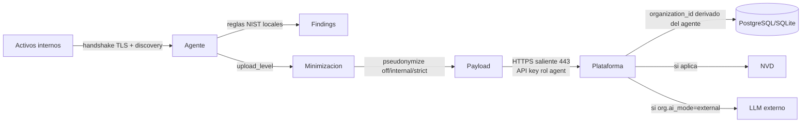
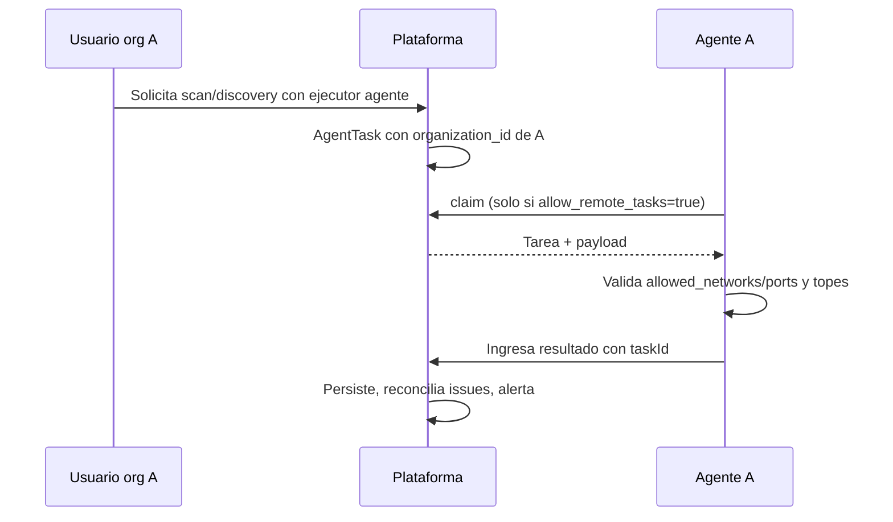

# Flujo de datos

Documenta que dato va a donde, si se guarda, si sale a terceros y si se
anonimiza. Refleja el codigo actual de `tls_analyzer/` (incluye agente,
multi-tenant y ejecutor cloud). Ver tambien
[`modelo_de_amenazas.md`](./modelo_de_amenazas.md) y
[`multitenant.md`](./multitenant.md).

## 1. Tabla de flujos

| Dato | Origen | Se guarda | Sale a terceros | Destino | Anonimizado / control |
|---|---|---|---|---|---|
| Password de usuario | `POST /api/auth/login`, `POST /api/users`, `POST /api/users/me/password` | Si, hash Argon2id (`User.password_hash`) | Nunca | — | Hash irreversible |
| Access token JWT | `auth_service` | No (cliente) | Nunca | — | Firmado HS256; vida corta |
| Refresh token | `auth_service` | Si, hash SHA-256 (`RefreshToken.token_hash`) | Nunca | — | Hash irreversible, rotacion y revocacion |
| API key de usuario/agente | `ApiKey` | Si, hash | Nunca | — | Hash; el agente la lee de `CRYPTOGUARD_AGENT_KEY` |
| Organizacion del request | `AuthContext` | No | Nunca | — | Derivada de usuario/API key/agente, no del payload |
| Host/IP de scan | `Scan.host`, `Scan.ip`, payload del agente | Si | Si (NVD/LLM segun caso) | NVD, LLM externo | En agente: `pseudonymize`; en LLM: `Anonymizer` |
| Datos de handshake | `Scan.scan_result` / payload | Si | Si (solo `upload_level=full` en handshake crudo; LLM recibe findings) | LLM externo | `minimal`/`standard` filtran; `make_untrusted_block` |
| Certificado (PEM/chain) | `Certificate`, payload del agente | Si (fingerprint, fechas, issuer, SAN) | No como PEM al LLM | DB | `minimal` envia solo resumen; `standard`/`full` completo |
| Subject/Issuer CN/SAN/O | `Certificate.subject`, `issuer` | Si | Nunca al LLM | — | `filter_cert_component` |
| serialNumber | `Certificate.serial_number` | Si | Nunca al LLM | — | Filtrado del prompt |
| Findings deterministicos | Motor de reglas NIST | Si (`Finding`) | Si (prompt LLM, si `ai_mode=external`) | LLM externo | `redact()` + minimizacion |
| CVE name/summary | NVD, `Cve` | Si | Si (prompt LLM) | LLM externo | `redact()`; la cache CVE es global |
| Consultas NVD (CPE/keyword) | `cve_service` | Cache local | Si | NVD API | CPE/producto/version; no incluye host ni IP |
| Prompt al LLM | `ai_recommendations._build_prompt` | No | Si, solo en `ai_mode=external` | Anthropic/Gemini | Anonimizado + bloques delimitados |
| Respuesta del LLM | Proveedor externo | Si (`Scan.ai_recommendation`) | No vuelve al proveedor | DB/frontend | `sanitize_llm_output` + `ensure_coverage` + `restore` |
| Logs de IA | Logger | Si (stdout) | No | — | No se loguea prompt/respuesta salvo `AI_LOG_PROMPTS=true` (anonimizado) |
| Discovery del agente | `DiscoveryResult` | Si (IP, hostname, puerto, servicio, TLS) | Si (plataforma) | API | `pseudonymize` segun modo; sin certificados |
| Tareas remotas | `AgentTask` | Si (tipo, payload, estado, intentos, resultado) | Si (agente) | Agente | Solo `scan`/`discovery`; validacion local de redes/puertos |
| Datos de auditoria | `AuditLog` | Si (actor, accion, entidad, IP, metadata) | No | — | Sin secretos; solo insercion desde la app |
| Metricas/dashboard | Frontend/Grafana | No en el backend | — | — | Reportes calculados desde DB |

## 2. Flujo de recoleccion (agente -> plataforma)

- El agente **solo inicia conexiones**; no abre puertos.
- La organizacion de todo lo ingestado se deriva del agente/API key, nunca de un
  campo del payload.
- `upload_level=minimal`: certificado resumido, sin SAN/subject/issuer, sin
  banners, sin chain, sin handshake crudo, sin `rawResult`.
- `upload_level=standard`: certificado/chain completos, handshake filtrado, sin
  banners ni `rawResult`.
- `upload_level=full`: agrega handshake completo y `rawResult`; solo depuracion.
- `pseudonymize=internal`: hostnames internos e IPs privadas -> `host-xxxxxx` /
  `ip-xxxxxx` (HMAC local). `strict`: todo. `off`: sin cambios.
- El mapeo pseudonimo -> real queda solo en el agente (`$STATE_DIR/mapping.json`)
  salvo exportacion manual.

## 3. Flujo de tareas remotas (opt-in)

Si la tarea no esta permitida, el agente la marca `rejected` sin hacer I/O de
red. El servidor aplica lease, reintentos y TTL; el agente no recibe comandos
arbitrarios.

## 4. Escaneo desde la nube (ejecutor cloud)

- Solo objetivos **publicos**. `cloud_guardrails.py` bloquea privados, loopback,
  link-local, metadatos de nube y rangos reservados.
- Resuelve DNS, valida todas las direcciones, fija la IP y revalida antes de
  conectar para evitar TOCTOU/rebinding.
- Requiere declaracion de autorizacion versionada y auditada; aplica cuotas por
  organizacion y limite de hosts de discovery.
- Los datos del objetivo publico se guardan en la organizacion que lo solicito y
  siguen el mismo flujo NVD/LLM.

## 5. IA por organizacion

- `Organization.ai_mode` es `template` o `external`.
- `template`: no hay llamada a proveedor externo; se usa recomendacion
  deterministica.
- `external`: solo si hay proveedor y API key configurados; el prompt sale con
  texto anonimizado/minimizado y bloques delimitados.
- La salida se sanea antes de persistir y se restaura la anonimizacion en el
  servidor; la DB guarda el texto final con datos reales.
- `AI_LOG_PROMPTS=false` por defecto; si se activa, solo se loguea la version
  anonimizada.

## 6. Datos globales vs. por organizacion

| Alcance | Datos |
|---|---|
| **Global** | `organizations` (metadata de tenants), `cves`, `cve_query_cache`, `alembic_version` |
| **Por organizacion** | Usuarios, agentes, tareas, activos, servicios, certificados, scans, findings, issues, alertas, umbrales, ventanas, discovery, API keys, integraciones, audit log, SLA y modo de IA |

La cache CVE no contiene datos del cliente; las consultas NVD revelan
producto/version pero no la identidad del host.

## 7. Retencion y borrado

- `delete-org --purge` borra los datos de la organizacion (con confirmacion).
- No hay purga automatica por antiguedad ni retencion configurable.
- Los backups los define el operador; hoy son manuales (`pg_dump`).
- Las cuentas de usuario se anonimizan al borrarse; los recursos pueden quedar
  sin owner.
