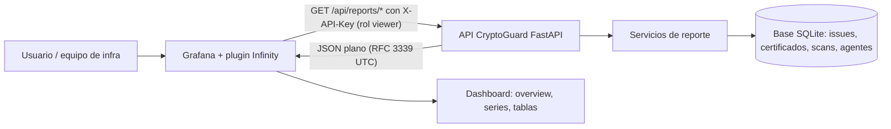

# Investigación: integración de CryptoGuard con Grafana

> Documento de la **Parte 6** del proyecto. Describe las vías evaluadas para
> exponer datos de CryptoGuard en Grafana, la alternativa elegida, cómo
> conectarla y sus limitaciones.

## 1. Objetivo

El proyecto ya cuenta con un dashboard propio (frontend React). Se pidió
**investigar** y disponer de un **dashboard personalizado y dinámico** para
equipos de infraestructura. El alcance definido es *investigación documentada +
una integración mínima demostrable y reproducible*: Grafana complementa el
frontend con series temporales y paneles a medida, sin reemplazarlo.

## 2. Vías evaluadas

| Vía | Esfuerzo | Ventajas | Desventajas | Seguridad | Mantenimiento |
|---|---|---|---|---|---|
| **Infinity / JSON datasource contra la API propia** | Bajo | Usa la API y los permisos existentes; sin tocar el esquema; paneles dinámicos; reutiliza reportes ya calculados | Cálculo bajo demanda (sin histórico pre-agregado); depende de que la API esté arriba | ApiKey de **solo lectura** (`viewer`), `allowedHosts` acotado, sin exponer la base | Bajo: el contrato son endpoints JSON estables |
| **Métricas Prometheus (`/metrics`)** | Medio | Series temporales nativas, alertas y retain; eficiente para históricos largos | Requiere agregar y mantener un exporter; alta cardinalidad si se rotula por host; duplica parte de la lógica de reportes | Endpoint protegido con token/`viewer`; nunca público | Medio: nuevas métricas y cardinalidad a cuidar |
| **PostgreSQL directo** | Medio | SQL flexible y potente; sin capa intermedia | Exige migrar de SQLite; acopla Grafana al esquema interno; permisos a nivel de tabla | Expone el esquema y credenciales de base a Grafana | Alto: cambios de esquema rompen paneles |

**Decisión:** se implementa como vía **principal** el *datasource Infinity contra
la API* (`/api/reports/*`) y se deja **Prometheus como vía secundaria/opcional**
(futuro). **PostgreSQL directo no se implementa.**

## 3. Por qué Infinity

- **Cero cambios de esquema y de despliegue:** se reutiliza la API y su modelo de
  permisos (Parte 1), sin migrar de SQLite ni exponer la base.
- **Contrato simple:** los reportes devuelven **arreglos JSON planos** con
  marcas RFC 3339 UTC, fáciles de mapear a paneles sin transformaciones complejas.
- **Seguridad acotada:** una `ApiKey` de rol `viewer` (solo lectura) y
  `allowedHosts` restringido al host de CryptoGuard.
- **Aprovecha lógica existente:** el cálculo de issues, SLA, certificados y
  Shadow IT ya vive en el backend; no se reimplementa en SQL de dashboards.
- **Portable:** dashboards y datasource versionados como código.

## 4. Flujo



1. Grafana pide datos con el datasource **Infinity**, enviando la `X-API-Key`
   `viewer` en cada request.
2. La API valida el rol (`viewer` o superior; una key `agent` recibe `403`),
   calcula el reporte y responde un arreglo JSON plano con cache
   `Cache-Control: private, max-age=60`.
3. Los paneles mapean el JSON a series, tablas y stats.

## 5. Cómo conectarlo (paso a paso)

1. **Crear la ApiKey `viewer`** (rol de solo lectura) desde el frontend
   (Integrations/API) o por API:

   ```bash
   curl -X POST "$CRYPTOGUARD_URL/api/api-keys" \
     -H "Authorization: Bearer <token-admin>" \
     -H "Content-Type: application/json" \
     -d '{"name":"grafana","role":"viewer","expiresInDays":365}'
   ```

2. **Configurar** `grafana/.env` a partir de `.env.example`
   (`CRYPTOGUARD_URL`, `CRYPTOGUARD_API_KEY`).
3. **`docker compose up -d`** en `grafana/` (Grafana + Infinity con versiones
   fijadas).
4. Abrir `http://localhost:3001` y el dashboard **CryptoGuard - Overview**.

El datasource se provisiona por código en
`grafana/provisioning/datasources/cryptoguard.yaml`: tipo
`yesoreyeram-infinity-datasource`, `auth_method: apiKey`, header `X-API-Key`,
`allowedHosts` acotado y el token en `secureJsonData`.

## 6. Paneles ↔ endpoint

| Panel | Tipo | Endpoint |
|---|---|---|
| Servicios totales | Stat | `/api/reports/summary` (`totalServices`) |
| Críticos abiertos | Stat | `/api/reports/summary` (`criticalOpen`) |
| Vencidos (SLA) | Stat | `/api/reports/summary` (`overdue`) |
| Sin owner | Stat | `/api/reports/summary` (`unassigned`) |
| Certificados <30d | Stat | `/api/reports/summary` (`certsExpiring30d`) |
| Score promedio | Stat | `/api/reports/summary` (`avgScore`) |
| Evolución del score TLS | Timeseries | `/api/reports/score-history` |
| Issues abiertos por severidad | Timeseries apilada | `/api/reports/issues-trend` |
| Certificados por vencimiento | Bar chart | `/api/reports/certificates-by-expiry` |
| Issues por responsable | Tabla | `/api/reports/issues-by-owner` |
| Issues por estado | Tabla | `/api/reports/issues-by-status` |
| Shadow IT vs. inventariado | Timeseries | `/api/reports/shadow-it-trend` |
| Estado de agentes on-premise | Tabla | `/api/reports/agents-status` |

Variables del dashboard (`agent`, `team`, `service`) se pueblan desde
`/api/reports/dimensions`, con opción "Todos".

## 7. Limitaciones

- **Cálculo bajo demanda:** no hay series pre-agregadas; cada panel consulta la
  API al refrescar. Con muchos bins o muchos paneles, conviene subir el
  intervalo de refresco o mover a Prometheus (6.5).
- **Sin tiempo real:** los datos dependen de cuándo corrieron los scans/agentes.
- **Rango del picker:** los reportes usan por defecto los últimos 90 días con
  `bucket=day`; el selector de rango de Grafana **no** se traduce a `from`/`to`
  (convertir epoch→RFC 3339 requeriría transformaciones extra).
- **Grafana no reemplaza al frontend:** es una vista complementaria de
  infraestructura; las acciones (asignar, aceptar riesgo, gestionar agentes)
  siguen en el frontend.
- **Control de acceso a nivel de dashboard** queda del lado de Grafana; la API
  solo garantiza que la key sea `viewer` (solo lectura).

## 8. Trabajo futuro

- **Prometheus como fuente principal** de series temporales (`/metrics`),
  reutilizando las consultas de `/api/reports/summary`.
- **Alertas nativas de Grafana** sobre umbrales de score, certificados o
  agentes caídos.
- **SSO compartido** entre el frontend y Grafana.
- **Retención/histórico pre-agregado** en la base para evitar cálculo en vivo.
